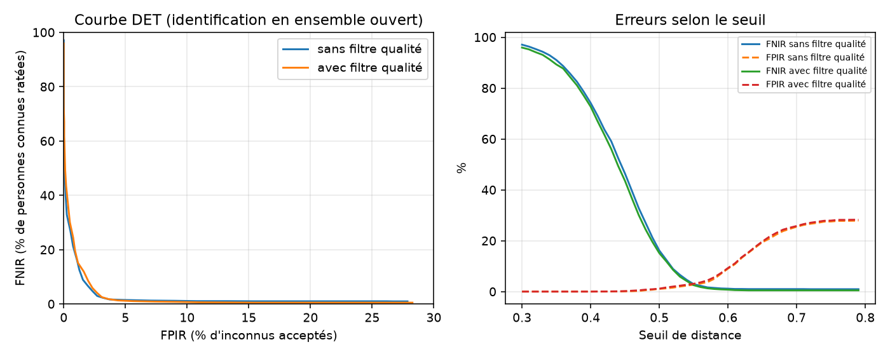

# Résultats d'évaluation

- Images : 1226, visage détecté : 1224, qualité suffisante : 996
- Identités connues / inconnues par tirage : 39 / 39
- Sondes légitimes ≈ 485, sondes imposteurs ≈ 624
- Inscription : 3 images par personne, moyenne sur 5 tirages aléatoires
- Motifs de rejet qualité : {'blurry': 162, 'not_frontal': 79, 'too_dark': 1, 'cut_off': 2, 'too_small': 1, 'no_face': 2}

FNIR = personnes connues non identifiées correctement. FPIR = inconnus acceptés à tort.
Taux calculés sur les images exploitables ; les images écartées sont comptées à part (« non acquises »).
En direct, une image écartée n'est pas une erreur : le système attend une meilleure image de la vidéo.

| Configuration | EER | FNIR à FPIR ≤ 1 % | FNIR / FPIR au seuil par défaut | Sondes non acquises |
|---|---|---|---|---|
| Sans filtre qualité | 3.1 ± 1.6 % | 16.4 % (seuil 0.51) | 16.1 % / 1.1 % | 1 / 485 |
| Avec filtre qualité | 3.0 ± 1.6 % | 19.1 % (seuil 0.51) | 15.1 % / 1.2 % | 112 / 485 |

