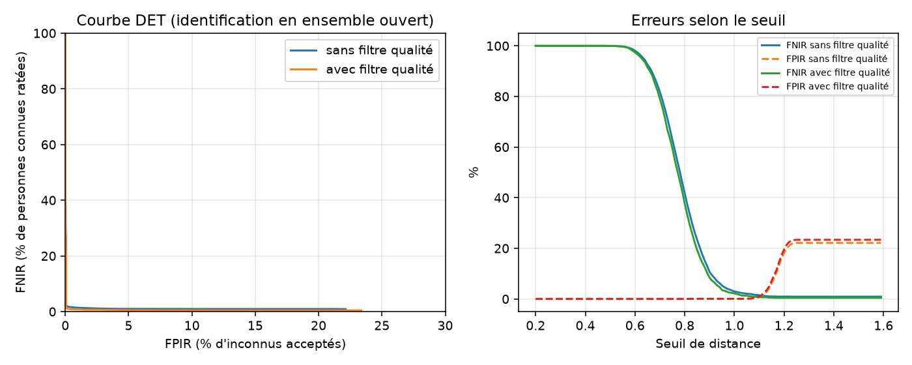

# Résultats d'évaluation

- Images : 1315, visage détecté : 1311, qualité suffisante : 1085
- Identités connues / inconnues par tirage : 40 / 40
- Sondes légitimes ≈ 524, sondes imposteurs ≈ 671
- Inscription : 3 images par personne, moyenne sur 5 tirages aléatoires
- Motifs de rejet qualité : {'blurry': 162, 'not_frontal': 69, 'no_face': 4, 'too_small': 2, 'cut_off': 6}

FNIR = personnes connues non identifiées correctement. FPIR = inconnus acceptés à tort.
Taux calculés sur les images exploitables ; les images écartées sont comptées à part (« non acquises »).
En direct, une image écartée n'est pas une erreur : le système attend une meilleure image de la vidéo.

| Configuration | EER | FNIR à FPIR ≤ 1 % | FNIR / FPIR au seuil par défaut | Sondes non acquises |
|---|---|---|---|---|
| Sans filtre qualité | 1.4 ± 0.5 % | 1.5 % (seuil 1.10) | 100.0 % / 0.0 % | 2 / 524 |
| Avec filtre qualité | 0.7 ± 0.3 % | 0.7 % (seuil 1.10) | 100.0 % / 0.0 % | 106 / 519 |

