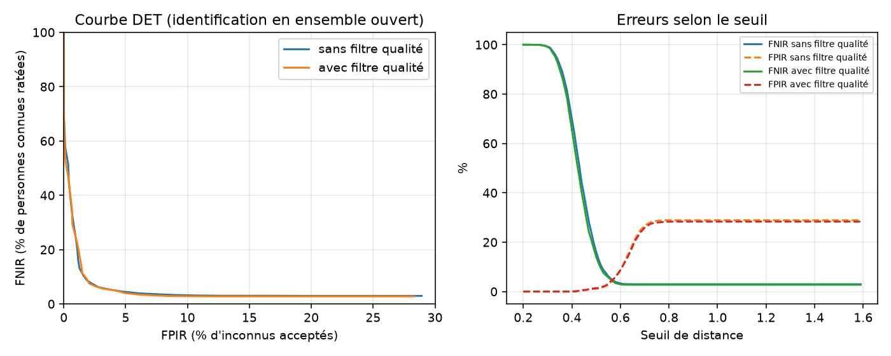

# Résultats d'évaluation

- Images : 1315, visage détecté : 1315, qualité suffisante : 1178
- Identités connues / inconnues par tirage : 40 / 40
- Sondes légitimes ≈ 524, sondes imposteurs ≈ 671
- Inscription : 3 images par personne, moyenne sur 5 tirages aléatoires
- Motifs de rejet qualité : {'not_frontal': 51, 'blurry': 70, 'too_small': 21, 'cut_off': 1}

FNIR = personnes connues non identifiées correctement. FPIR = inconnus acceptés à tort.
Taux calculés sur les images exploitables ; les images écartées sont comptées à part (« non acquises »).
En direct, une image écartée n'est pas une erreur : le système attend une meilleure image de la vidéo.

| Configuration | EER | FNIR à FPIR ≤ 1 % | FNIR / FPIR au seuil par défaut | Sondes non acquises |
|---|---|---|---|---|
| Sans filtre qualité | 4.7 ± 0.8 % | 26.8 % (seuil 0.49) | 16.2 % / 1.2 % | 0 / 524 |
| Avec filtre qualité | 4.5 ± 0.7 % | 28.7 % (seuil 0.48) | 14.2 % / 1.4 % | 68 / 524 |

