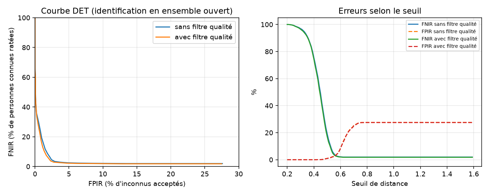

# Résultats d'évaluation

- Images : 1226, visage détecté : 1226, qualité suffisante : 1097
- Identités connues / inconnues par tirage : 39 / 39
- Sondes légitimes ≈ 485, sondes imposteurs ≈ 624
- Inscription : 3 images par personne, moyenne sur 5 tirages aléatoires
- Motifs de rejet qualité : {'blurry': 70, 'not_frontal': 45, 'too_small': 17, 'cut_off': 1}

FNIR = personnes connues non identifiées correctement. FPIR = inconnus acceptés à tort.
Taux calculés sur les images exploitables ; les images écartées sont comptées à part (« non acquises »).
En direct, une image écartée n'est pas une erreur : le système attend une meilleure image de la vidéo.

| Configuration | EER | FNIR à FPIR ≤ 1 % | FNIR / FPIR au seuil par défaut | Sondes non acquises |
|---|---|---|---|---|
| Sans filtre qualité | 3.4 ± 1.2 % | 17.9 % (seuil 0.51) | 19.2 % / 1.0 % | 0 / 485 |
| Avec filtre qualité | 3.2 ± 1.4 % | 16.1 % (seuil 0.52) | 17.1 % / 0.9 % | 63 / 485 |

